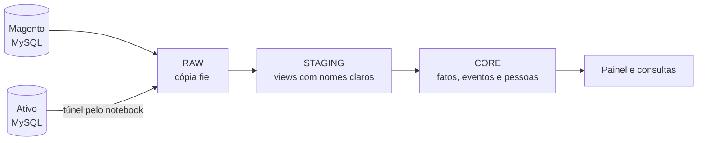

# Banco Central de Dados

Pipeline que copia as vendas de **Magento** e **Ativo** para o PostgreSQL `Atendimento`
e as transforma em uma base única de pedidos, inscrições, eventos e pessoas.

Roda de hora em hora no servidor. O MySQL das origens é só lido; nada é escrito lá.

## Como os dados fluem



| Camada | Schema | O que faz | Onde está |
|---|---|---|---|
| RAW | `raw` | Copia as origens sem aplicar regra | `src/pipeline`, `src/sources`, `sql/postgres` |
| STAGING | `staging` | Views com tipos e nomes padronizados; não há carga | `sql/staging` |
| CORE | `core` | Aplica as regras de negócio e guarda o resultado | `src/core`, `sql/core/v1` |
| Automação | – | Roda o ciclo e leva à CORE só o que mudou | `src/automation`, `deploy/server` |

A view `core.fato_inscricao_indicadores_validos` fica fechada de propósito, com
`WHERE FALSE`, e a automação se recusa a rodar se ela abrir.

## Por onde começar

| Quero... | Leia |
|---|---|
| Ver se está tudo funcionando ou resolver uma falha | [Operação](docs/OPERACAO.md) |
| Entender as etapas do ciclo | [Automação](docs/AUTOMACAO_LOCAL_RAW_CORE.md) |
| Saber como uma inscrição é contada ou classificada | [Regras de negócio](docs/CORE_REGRAS_DE_NEGOCIO.md) |
| Entender os KPIs de crescimento de vendas | [Sales Growth](docs/KPIS_SALES_GROWTH.md) |
| Saber de onde vem um campo da CORE | [Dicionário](docs/CORE_V1_DICIONARIO.md) |
| Entender pessoas, CPF e KPIs | [Pessoas](docs/CORE_DIM_PESSOA_CONTATO.md) |
| Instalar uma versão no servidor | [Deploy](docs/DEPLOY_SERVIDOR_SEM_DOCKER.md) |
| Ver o que está em aberto | [Pendências](docs/CORE_PENDENCIAS.md) |
| Ver todos os documentos | [Índice](docs/README.md) |

## Glossário

| Termo | Significado |
|---|---|
| Inscrição | Uma pessoa em uma prova: `sa_pedido_evento` no Ativo, bundle pai no Magento |
| Pedido | A compra, que pode ter várias inscrições |
| Evento | A prova. Mesmo SKU no Ativo e no Magento é a mesma prova |
| Combo | Pacote com várias provas, vendido no Ativo |
| Balcão | Cadastro do atleta no Ativo, separado de quem fez a compra |
| Inscritos | Inscrições com `contabiliza_inscricao` verdadeiro |
| Pessoa única | Pessoa com CPF válido. Sem isso, não entra nos KPIs de pessoas |
| Watermark | Até onde uma tabela já foi lida na origem |
| Diário | Lista de IDs alterados que ainda precisam ir à CORE |
| Túnel | Conexão pelo notebook que dá ao servidor acesso ao MySQL do Ativo |

## Rodar localmente

Requer Python 3.11 ou superior:

```powershell
python -m venv .venv
.venv\Scripts\python -m pip install -r requirements-dev.txt
Copy-Item .env.example .env
.venv\Scripts\python -m pytest -q
```

Preencha o `.env`, que o Git ignora, e nunca o compartilhe. Variáveis de ambiente têm
prioridade sobre ele. Os testes que dependem de banco ficam pulados sem o laboratório
([`homologation/core-v1`](homologation/core-v1/README.md)).

## Comandos principais

```powershell
# Testar conexões, sem alterar nada
.venv\Scripts\python -m src.main check

# Consultar colunas e índices da origem, sem ler registros
.venv\Scripts\python -m src.main inspect --source ativo --table sa_pedido

# Carregar uma entidade RAW
.venv\Scripts\python -m src.main incremental --source magento --entity sales_order

# Ver contagens pendentes da automação, sem expor registros
.venv\Scripts\python -m src.automation.local_raw_core plan-core
```

Todos os comandos e o funcionamento de cada tabela RAW estão em
[RAW por entidade](docs/RAW_ENTIDADES.md).

## Segurança

- `Atendimento` é o único destino aceito. A CORE exige aprovação explícita para escrever nele.
- As origens são lidas em transação `READ ONLY`, com TLS validado.
- Logs e erros não trazem valores de linhas, senhas ou dados pessoais.
- CPF, nome e e-mail ficam só em `core.dim_pessoa`. Os fatos guardam apenas a chave.
- Não coloque dados pessoais, senhas nem planilhas no repositório.

## Contribuir

Toda mudança de pipeline, regra ou operação atualiza a documentação no mesmo PR. O
[índice](docs/README.md) diz qual documento cobre cada assunto. Migrações CORE só entram
no fim de `MIGRATIONS` em `src/core/runner.py` ([mapa](sql/core/v1/README.md)).
